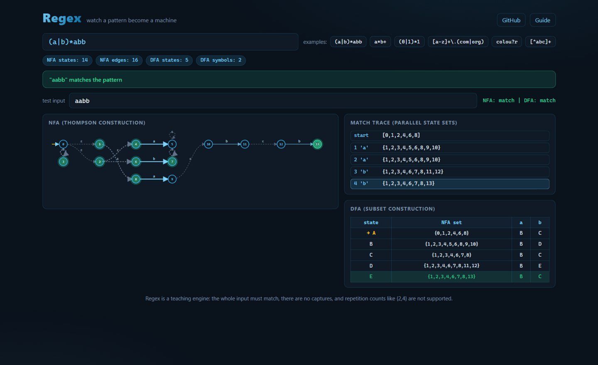

# Regex

[](https://github.com/rajpalgelot-tech/regex-engine-simulator/actions/workflows/ci.yml)
[](https://rajpalgelot-tech.github.io/regex-engine-simulator/)

A regex engine built the way the textbooks teach it, running live in your browser. Type a pattern and watch Thompson's construction assemble an NFA state by state, the subset construction fold it into a DFA transition table, and a test input push sets of parallel states through the machine one character at a time.



## Why does this exist?

Most regex tutorials stop at "here is a pattern, it matches". The interesting part is the machine underneath: how does a pile of epsilon edges decide anything? This project shows the whole pipeline from pattern to machine to verdict, with the state sets written out at every step, so "the NFA is in states {1,2,4,7} and reads a" stops being abstract. It is also the classic compilers-course exercise (build Thompson's construction, then the subset construction), done end to end and testable.

## The supported syntax

| Syntax | Meaning |
| --- | --- |
| `a`, `9`, any literal character | matches itself |
| `.` | exactly one of anything |
| `[abc]`, `[a-z0-9]` | one character from the class |
| `[^abc]` | one character not in the class |
| `P*`, `P+`, `P?` | zero or more, one or more, optional |
| `PQ` | P then Q |
| `P\|Q` | P or Q |
| `(P)` | grouping |
| `\x` | literal x, for escaping `* + ? ( ) [ ] . \ |` |

The whole input must match (like an anchored regex). There are no captures, anchors, or `{n,m}` repetition counts.

## What you can do

| Control | What it does |
| --- | --- |
| Pattern input | Rebuilds the NFA and DFA as you type; errors come back with positions |
| Test input | Runs both engines over the text and shows the verdict for each |
| Examples | Six classics, starting with `(a|b)*abb` from the dragon book |
| NFA graph | The Thompson construction, auto laid out left to right; states alive after your input glow green |
| Match trace | The parallel state set after every character, dead ends marked "stuck" |
| DFA table | The subset construction: named states, their NFA sets, and one column per distinct symbol |

## Three experiments worth trying

1. **Watch the state sets breathe.** Load `(a|b)*abb` and type `aabb`. After each character the trace shows the set of states the NFA occupies in parallel; when the last `b` lands, state 13 (the accept) joins the set and the banner turns green. Try `abba` and watch the set die.
2. **See the machine shrink.** The stats chips show 14 NFA states becoming 5 DFA states for the classic pattern. Try `a*b+`: more repetition in the pattern means more epsilon edges, and the DFA often stays tiny. The DFA table's "NFA set" column shows exactly which NFA states each DFA state stands for.
3. **Break a pattern on purpose.** Type `(ab` or `a[bc` and read the error: the parser reports the position and the reason. Then fix it and watch the machine rebuild.

## How it works

- **Parser** (`src/regex/parser.ts`): a recursive-descent parser (alternation, then concatenation, then postfix repetition, then atoms) producing an AST, with position-tagged errors for unclosed groups, unmatched brackets, dangling quantifiers, and backwards character ranges.
- **Thompson construction** (`src/regex/nfa.ts`): every AST node becomes a fragment with one start and one accept state. Concatenation glues fragments with epsilon edges; alternation forks and joins; star adds skip and loop edges. No state ever has more than two epsilon out-edges, exactly like the construction in the book.
- **Simulation** (`simulate`): the NFA never backtracks. It holds a set of parallel states, closes each step over epsilon edges, and advances on the input character. If the accept state is in the set after the last character, it matches.
- **Subset construction** (`src/regex/dfa.ts`): each DFA state is the set of NFA states reachable so far; transitions are computed per distinct edge predicate, so the table has one column per symbol class. DFA states get names A, B, C... for the table.
- **Determinism**: no randomness anywhere. The same pattern always produces the same NFA and DFA, which the tests assert directly.

## Honest limitations

- The whole input must match; there is no substring search or capture groups.
- No `{n,m}` counted repetition, no lookahead, no anchors, no Unicode classes.
- The DFA is not minimized; equivalent states stay separate, which is visible in the table.
- The NFA layout is a longest-path layering, so very long patterns produce a very wide graph.

## Code tour

```
src/
  regex/
    parser.ts    recursive-descent parser producing an AST with position errors
    nfa.ts       Thompson construction, epsilon closure, parallel-set simulation
    dfa.ts       subset construction and the DFA transition table
  ui/
    app.ts       SVG graph layout, trace table, DFA table, live input
    styles.css   the dark sky-blue theme
tests/
  regex.test.ts  21 tests: parser errors, matching semantics, NFA/DFA equivalence
```

## Development

```bash
npm install
npm run dev        # the machine at http://localhost:5173
npm test           # vitest, all deterministic
npm run build      # typecheck plus a static build in dist/
```

## License

MIT, see [LICENSE](LICENSE).
